# Showcase device screenshots

App revision: `e4ec7441`
Base handoff: `a2c48c0b9ebf3524192e680ecd4becc1f2880bb8`

Every image is a PNG captured from the live GitHub-hosted Android emulator or
iOS Simulator through ui-test-actions. Host renders and mockups are not used.

## android

- Run: https://github.com/NativeCmpKit/NativeCmpKit/actions/runs/45957524569
- Job/attempt: `140367856551` / `1`
- Device: Pixel 6 API 35 Google APIs x86_64, 1080x2400 @ 420 dpi
- Runtime: Android 15 (API 35)
- ui-test-actions: `0c818c5d72e8c30c59bd1287c330a40392bf8e89`

| Capture | Component / scenario | Expected observation | Image |
| --- | --- | --- | --- |
| `geo-math/overview` | geo-math | Deterministic LatLng distance/bearing plus the tracker-unavailable state. |  |
| `home/index` | home | Searchable component index, stable routes and per-screen reset. |  |
| `io-camera-picker/overview` | io-camera-picker | Camera launch and the platform-specific unavailable fallback. | 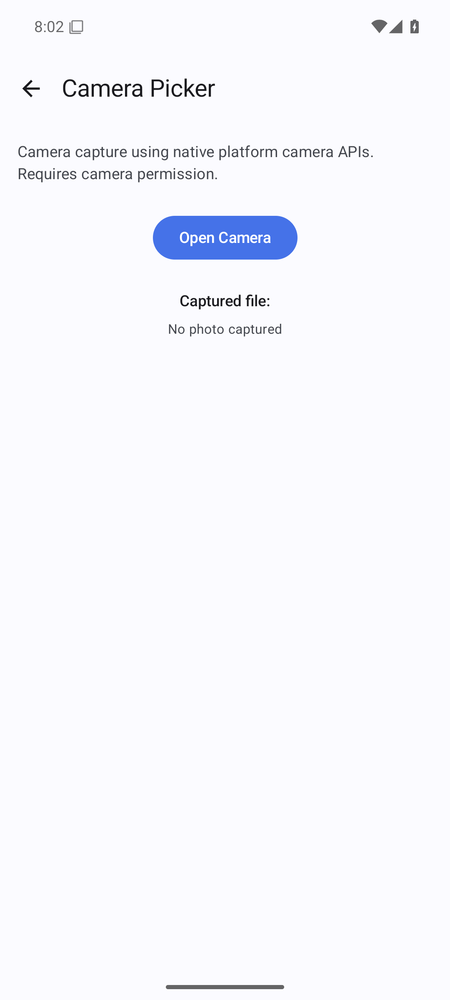 |
| `io-file-picker/overview` | io-file-picker | Platform file selection, filters, metadata and streaming readout. | 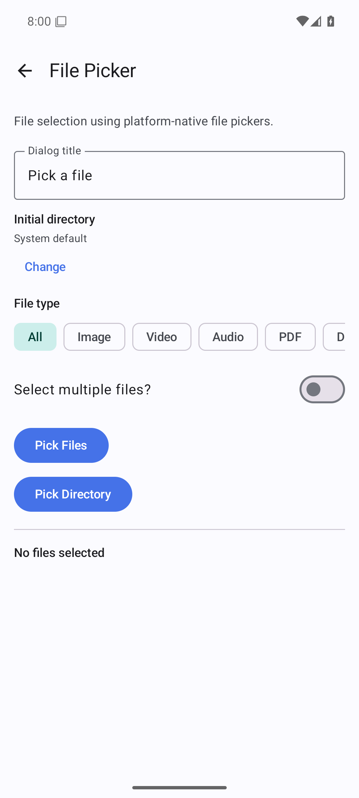 |
| `io-file-saver/overview` | io-file-saver | Save/export entry point and result state. | 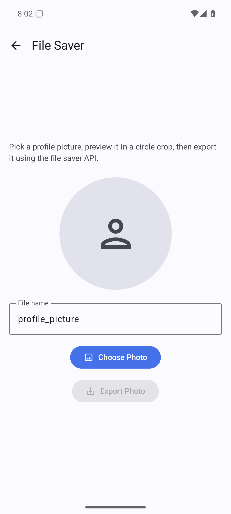 |
| `io-image-picker/overview` | io-image-picker | Picked image preview through the KmpFile Coil pipeline. | 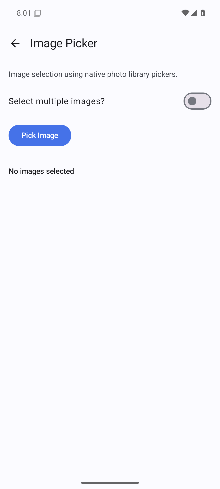 |
| `limitations/known-limitations` | limitations | Source-confirmed unsupported and internal APIs; not working parity. | 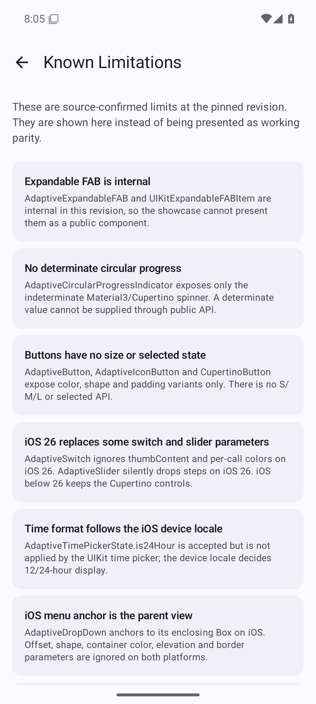 |
| `permissions/overview` | permissions | Public permission status and request rows; OS dialogs are separate. |  |
| `share/overview` | share | Native share payloads and terminal result state. | 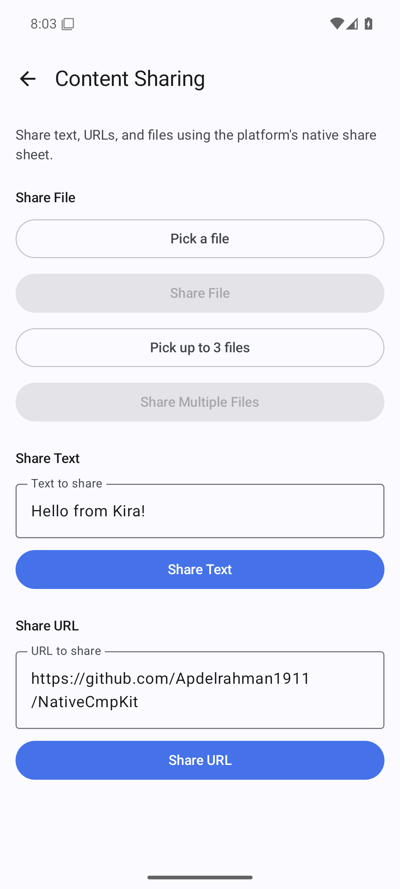 |
| `ui-adaptive-alert-dialog/overview` | ui-adaptive-alert-dialog | The confirm action enables after typing / Secure/number-pad fields are configured / Critical severity is applied on supported UIKit hosts | 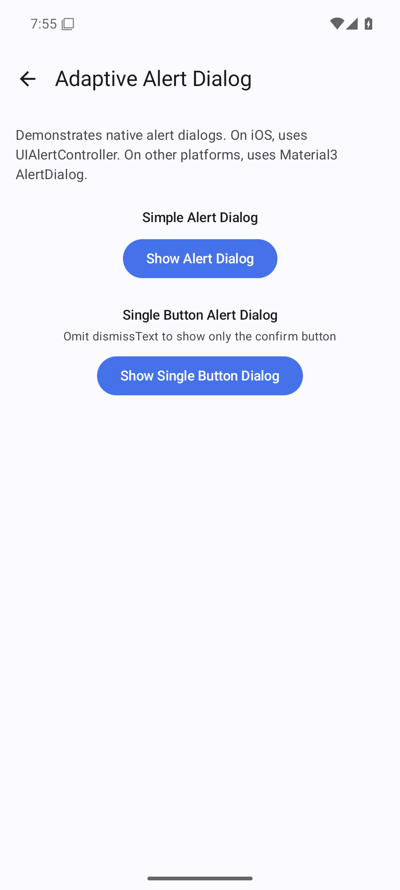 |
| `ui-adaptive-alert-dialog/simple` | ui-adaptive-alert-dialog | Cancel closes without a confirmation / Ok closes and records the confirmation |  |
| `ui-adaptive-bottom-sheet/expanded` | ui-adaptive-bottom-sheet | The sheet presents with a drag handle / Dismissal reports back / The iOS inset/shape parameters are ignored | 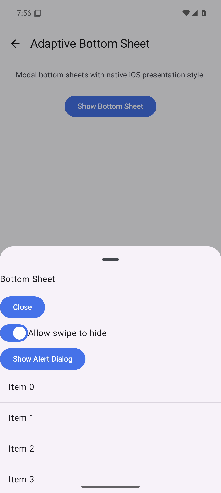 |
| `ui-adaptive-bottom-sheet/overview` | ui-adaptive-bottom-sheet | See coverage.json |  |
| `ui-adaptive-button/overview` | ui-adaptive-button | Counter increments from 0 to 1 / The disabled button stays visible and unchanged |  |
| `ui-adaptive-clickable/overview` | ui-adaptive-clickable | Each gesture is counted once / The disabled card stays inert / The Material platform shows indication while iOS uses press scale | 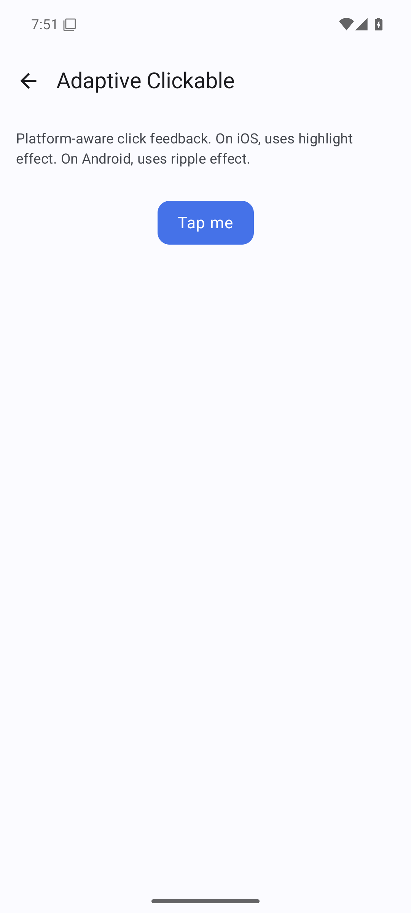 |
| `ui-adaptive-date-picker/overview` | ui-adaptive-date-picker | The readout changes / The native iOS calendar or Material picker is used | 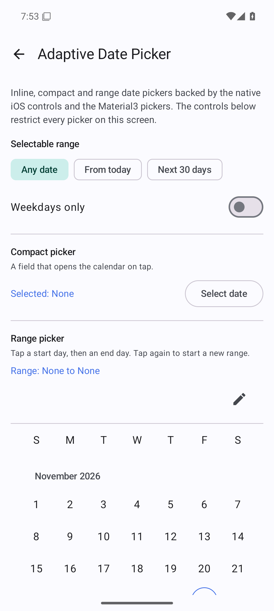 |
| `ui-adaptive-dropdown/menu` | ui-adaptive-dropdown | The selected action readout changes / The destructive item is styled as destructive / The disabled item does not fire | 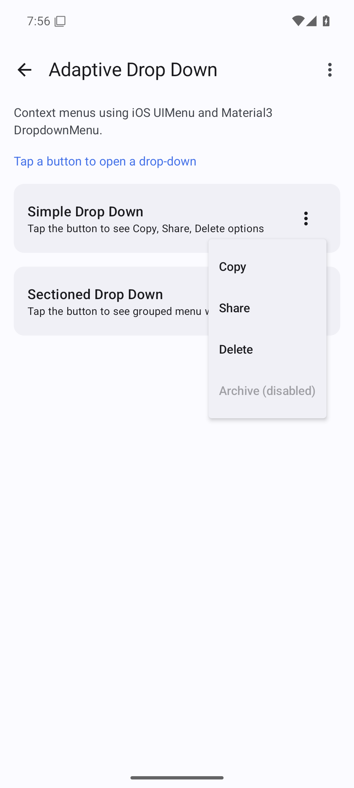 |
| `ui-adaptive-dropdown/overview` | ui-adaptive-dropdown | See coverage.json |  |
| `ui-adaptive-navigation-bar/overview` | ui-adaptive-navigation-bar | The selected tab changes / No selection is possible with an invalid index | 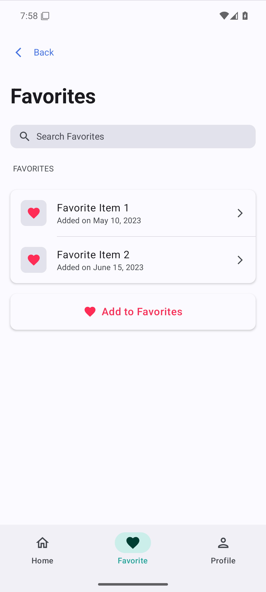 |
| `ui-adaptive-progress/overview` | ui-adaptive-progress | All three indeterminate indicators render and animate / No determinate progress control is advertised |  |
| `ui-adaptive-scaffold/overview` | ui-adaptive-scaffold | Content is not obscured by the bars / The tab selection changes |  |
| `ui-adaptive-slider/overview` | ui-adaptive-slider | The percentage follows the thumb / The value stays within 0..100 |  |
| `ui-adaptive-switch/overview` | ui-adaptive-switch | The readout follows the checked state / The disabled switch does not change |  |
| `ui-adaptive-time-picker/overview` | ui-adaptive-time-picker | Both time readouts render / The iOS format follows the device locale even when is24Hour differs |  |
| `ui-adaptive-toolbar/overview` | ui-adaptive-toolbar | The Material toolbar expands / iOS requires non-empty iosItems and shows a native toolbar |  |
| `ui-adaptive-top-bar/overview` | ui-adaptive-top-bar | The title is visible / Bar items render natively on iOS / The menu action fires | 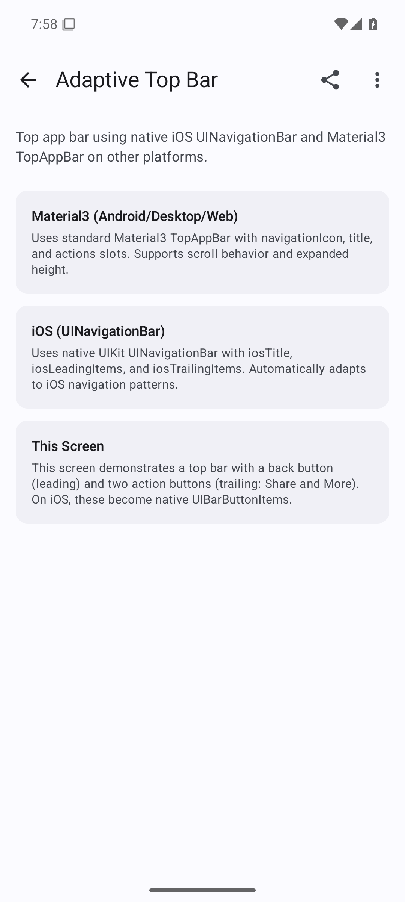 |
| `ui-cupertino-icons/overview` | ui-cupertino-icons | See coverage.json |  |
| `ui-cupertino-icons/search-chevron` | ui-cupertino-icons | The grid filters to matching names / The count updates / Representative glyphs render without tofu |  |
| `webview/cookie-roundtrip` | webview | Deterministic HTML, navigation/errors, JavaScript and cookie state. |  |
| `webview/cookies-cleared` | webview | Deterministic HTML, navigation/errors, JavaScript and cookie state. |  |
| `webview/invalid-destination` | webview | Deterministic HTML, navigation/errors, JavaScript and cookie state. | 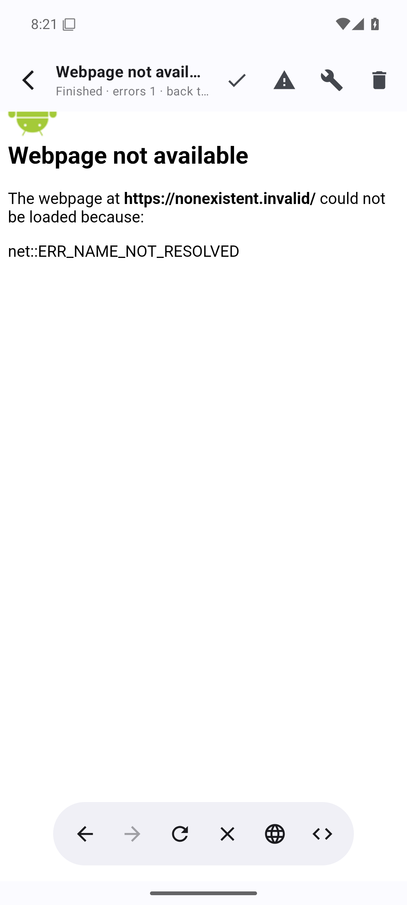 |
| `webview/javascript-title` | webview | Deterministic HTML, navigation/errors, JavaScript and cookie state. | 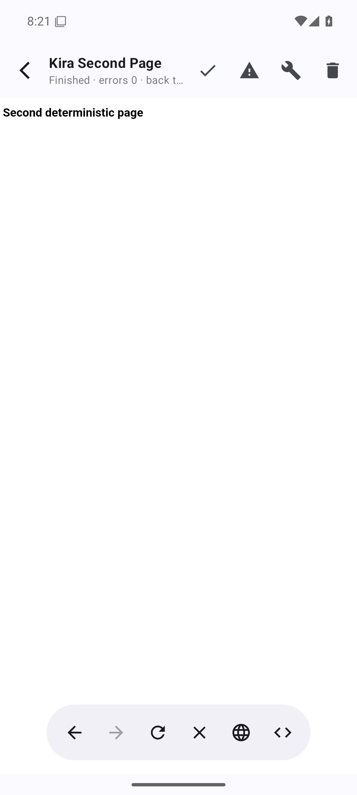 |
| `webview/overview` | webview | Deterministic HTML, navigation/errors, JavaScript and cookie state. |  |
| `webview/second-page` | webview | Deterministic HTML, navigation/errors, JavaScript and cookie state. |  |

## ios

- Run: https://github.com/NativeCmpKit/NativeCmpKit/actions/runs/45968953555
- Job/attempt: `140404371284` / `1`
- Device: iPhone simulator via AXe, 402x874
- Runtime: iOS 26.5 simulator (Xcode 26.6)
- ui-test-actions: `0c818c5d72e8c30c59bd1287c330a40392bf8e89`

| Capture | Component / scenario | Expected observation | Image |
| --- | --- | --- | --- |
| `geo-math/overview` | geo-math | Deterministic LatLng distance/bearing plus the tracker-unavailable state. |  |
| `home/index` | home | Searchable component index, stable routes and per-screen reset. |  |
| `io-camera-picker/overview` | io-camera-picker | Camera launch and the platform-specific unavailable fallback. | 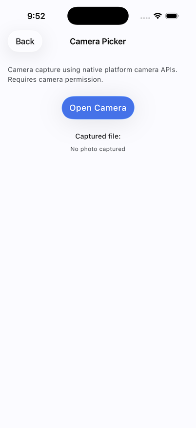 |
| `io-file-picker/overview` | io-file-picker | Platform file selection, filters, metadata and streaming readout. | 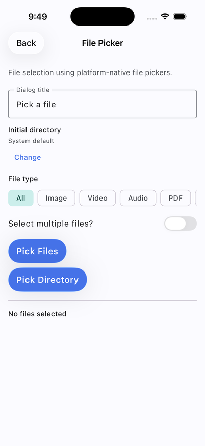 |
| `io-file-saver/overview` | io-file-saver | Save/export entry point and result state. |  |
| `io-image-picker/overview` | io-image-picker | Picked image preview through the KmpFile Coil pipeline. |  |
| `limitations/known-limitations` | limitations | Source-confirmed unsupported and internal APIs; not working parity. | 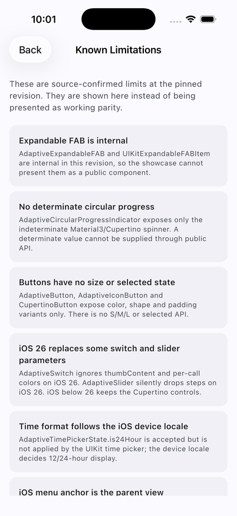 |
| `permissions/overview` | permissions | Public permission status and request rows; OS dialogs are separate. |  |
| `share/overview` | share | Native share payloads and terminal result state. | 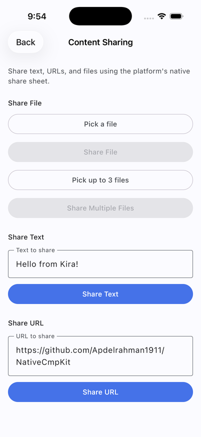 |
| `ui-adaptive-alert-dialog/overview` | ui-adaptive-alert-dialog | The confirm action enables after typing / Secure/number-pad fields are configured / Critical severity is applied on supported UIKit hosts |  |
| `ui-adaptive-alert-dialog/simple` | ui-adaptive-alert-dialog | Cancel closes without a confirmation / Ok closes and records the confirmation |  |
| `ui-adaptive-bottom-sheet/expanded` | ui-adaptive-bottom-sheet | The sheet presents with a drag handle / Dismissal reports back / The iOS inset/shape parameters are ignored | 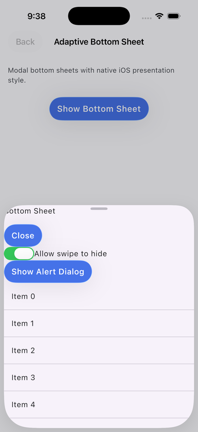 |
| `ui-adaptive-bottom-sheet/overview` | ui-adaptive-bottom-sheet | See coverage.json |  |
| `ui-adaptive-button/overview` | ui-adaptive-button | Counter increments from 0 to 1 / The disabled button stays visible and unchanged |  |
| `ui-adaptive-clickable/overview` | ui-adaptive-clickable | Each gesture is counted once / The disabled card stays inert / The Material platform shows indication while iOS uses press scale | 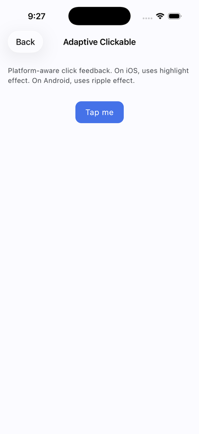 |
| `ui-adaptive-date-picker/overview` | ui-adaptive-date-picker | The readout changes / The native iOS calendar or Material picker is used |  |
| `ui-adaptive-dropdown/menu` | ui-adaptive-dropdown | The selected action readout changes / The destructive item is styled as destructive / The disabled item does not fire |  |
| `ui-adaptive-dropdown/overview` | ui-adaptive-dropdown | See coverage.json |  |
| `ui-adaptive-navigation-bar/overview` | ui-adaptive-navigation-bar | The selected tab changes / No selection is possible with an invalid index | 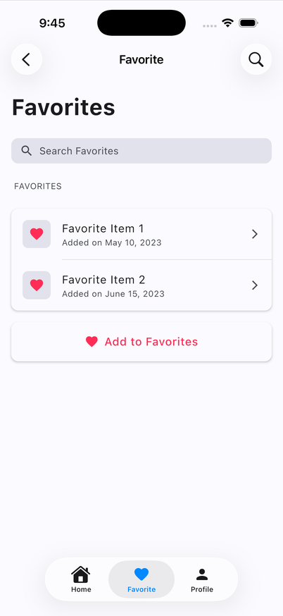 |
| `ui-adaptive-progress/overview` | ui-adaptive-progress | All three indeterminate indicators render and animate / No determinate progress control is advertised | 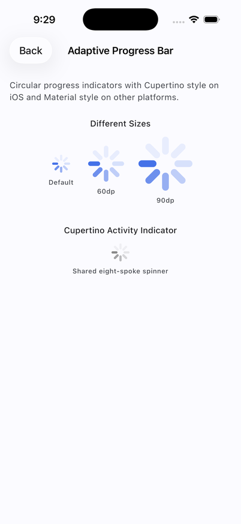 |
| `ui-adaptive-scaffold/overview` | ui-adaptive-scaffold | Content is not obscured by the bars / The tab selection changes | 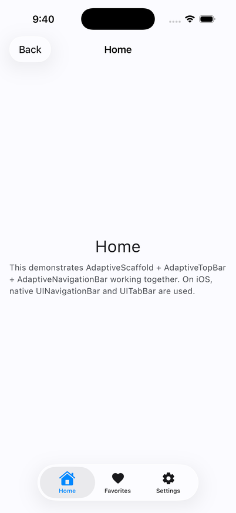 |
| `ui-adaptive-slider/overview` | ui-adaptive-slider | The percentage follows the thumb / The value stays within 0..100 |  |
| `ui-adaptive-switch/overview` | ui-adaptive-switch | The readout follows the checked state / The disabled switch does not change | 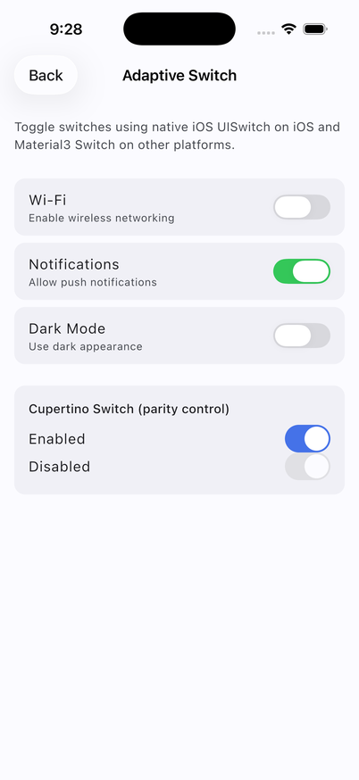 |
| `ui-adaptive-toolbar/overview` | ui-adaptive-toolbar | The Material toolbar expands / iOS requires non-empty iosItems and shows a native toolbar |  |
| `ui-adaptive-top-bar/overview` | ui-adaptive-top-bar | The title is visible / Bar items render natively on iOS / The menu action fires |  |
| `ui-cupertino-icons/overview` | ui-cupertino-icons | The grid filters to matching names / The count updates / Representative glyphs render without tofu | 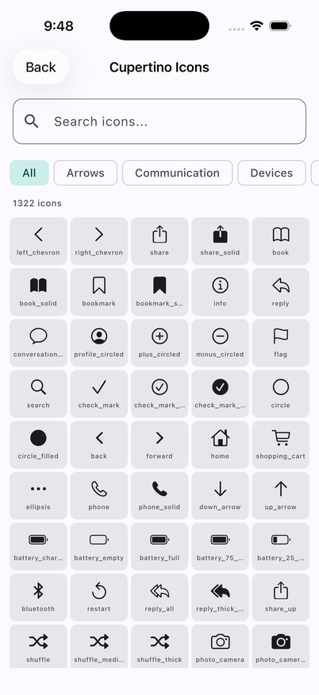 |
| `webview/cookie-roundtrip` | webview | Deterministic HTML, navigation/errors, JavaScript and cookie state. |  |
| `webview/cookies-cleared` | webview | Deterministic HTML, navigation/errors, JavaScript and cookie state. |  |
| `webview/invalid-destination` | webview | Deterministic HTML, navigation/errors, JavaScript and cookie state. |  |
| `webview/javascript-title` | webview | Deterministic HTML, navigation/errors, JavaScript and cookie state. |  |
| `webview/overview` | webview | Deterministic HTML, navigation/errors, JavaScript and cookie state. |  |

## Side-by-side Android / iOS

- [geo-math/overview.png](screenshots/compare/geo-math/overview.png)
- [home/index.png](screenshots/compare/home/index.png)
- [io-camera-picker/overview.png](screenshots/compare/io-camera-picker/overview.png)
- [io-file-picker/overview.png](screenshots/compare/io-file-picker/overview.png)
- [io-file-saver/overview.png](screenshots/compare/io-file-saver/overview.png)
- [io-image-picker/overview.png](screenshots/compare/io-image-picker/overview.png)
- [limitations/known-limitations.png](screenshots/compare/limitations/known-limitations.png)
- [permissions/overview.png](screenshots/compare/permissions/overview.png)
- [share/overview.png](screenshots/compare/share/overview.png)
- [ui-adaptive-alert-dialog/overview.png](screenshots/compare/ui-adaptive-alert-dialog/overview.png)
- [ui-adaptive-alert-dialog/simple.png](screenshots/compare/ui-adaptive-alert-dialog/simple.png)
- [ui-adaptive-bottom-sheet/expanded.png](screenshots/compare/ui-adaptive-bottom-sheet/expanded.png)
- [ui-adaptive-bottom-sheet/overview.png](screenshots/compare/ui-adaptive-bottom-sheet/overview.png)
- [ui-adaptive-button/overview.png](screenshots/compare/ui-adaptive-button/overview.png)
- [ui-adaptive-clickable/overview.png](screenshots/compare/ui-adaptive-clickable/overview.png)
- [ui-adaptive-date-picker/overview.png](screenshots/compare/ui-adaptive-date-picker/overview.png)
- [ui-adaptive-dropdown/menu.png](screenshots/compare/ui-adaptive-dropdown/menu.png)
- [ui-adaptive-dropdown/overview.png](screenshots/compare/ui-adaptive-dropdown/overview.png)
- [ui-adaptive-navigation-bar/overview.png](screenshots/compare/ui-adaptive-navigation-bar/overview.png)
- [ui-adaptive-progress/overview.png](screenshots/compare/ui-adaptive-progress/overview.png)
- [ui-adaptive-scaffold/overview.png](screenshots/compare/ui-adaptive-scaffold/overview.png)
- [ui-adaptive-slider/overview.png](screenshots/compare/ui-adaptive-slider/overview.png)
- [ui-adaptive-switch/overview.png](screenshots/compare/ui-adaptive-switch/overview.png)
- [ui-adaptive-toolbar/overview.png](screenshots/compare/ui-adaptive-toolbar/overview.png)
- [ui-adaptive-top-bar/overview.png](screenshots/compare/ui-adaptive-top-bar/overview.png)
- [ui-cupertino-icons/overview.png](screenshots/compare/ui-cupertino-icons/overview.png)
- [webview/cookie-roundtrip.png](screenshots/compare/webview/cookie-roundtrip.png)
- [webview/cookies-cleared.png](screenshots/compare/webview/cookies-cleared.png)
- [webview/invalid-destination.png](screenshots/compare/webview/invalid-destination.png)
- [webview/javascript-title.png](screenshots/compare/webview/javascript-title.png)
- [webview/overview.png](screenshots/compare/webview/overview.png)

## Status

The per-row execution state is maintained in
[showcase/coverage.json](../showcase/coverage.json) and summarized in
[showcase/COVERAGE.md](../showcase/COVERAGE.md). A capture proves the screen
rendered on that device; interaction assertions are recorded separately and
must name the run/attempt/job that produced them.

Unsupported rows point at the Known Limitations screen and are marked
`not-applicable`; they are not evidence of working functionality.
